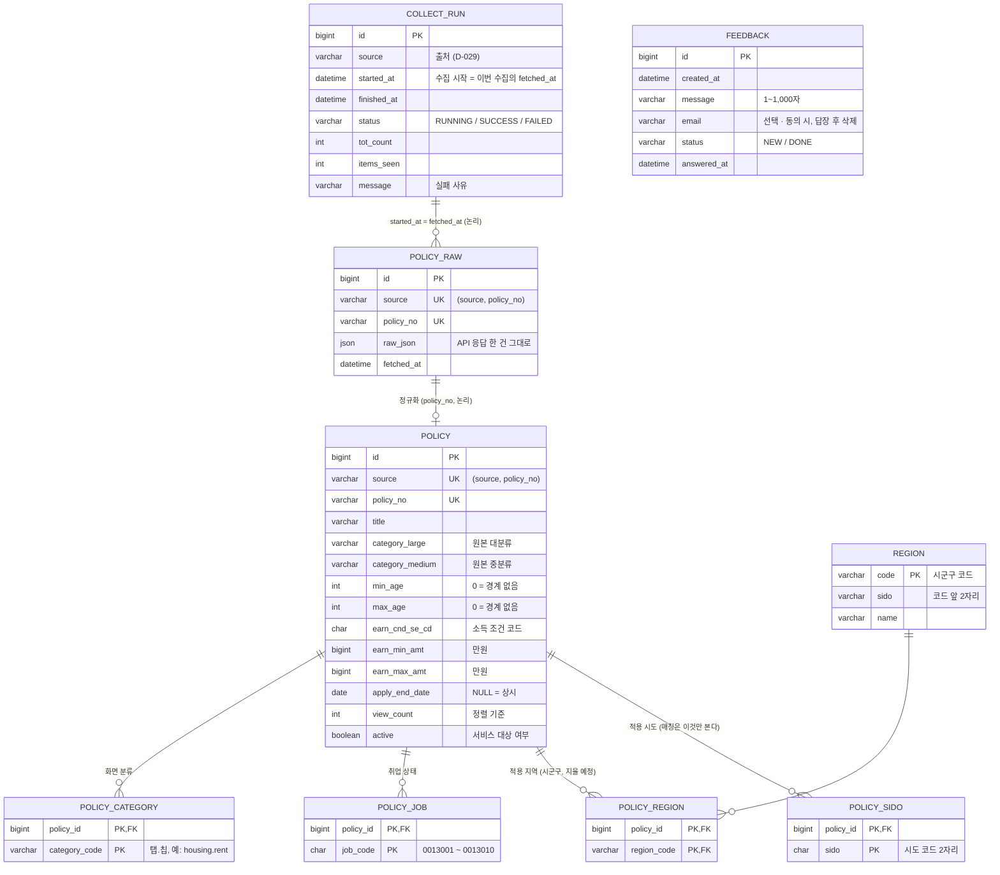
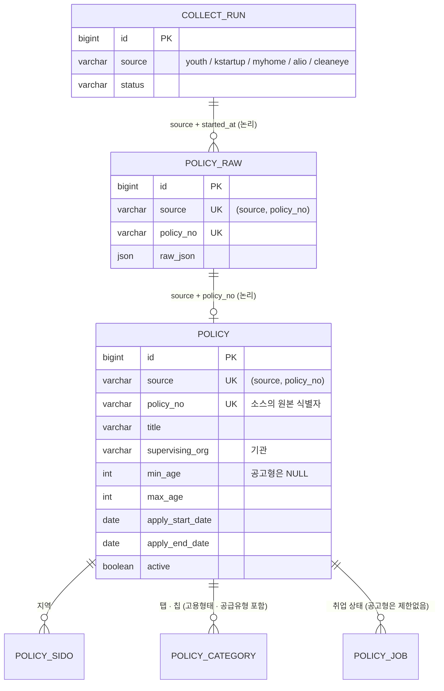

# ERD — 청년정책 매칭 서비스

기준: Flyway 마이그레이션 V1 ~ V10 (2026-11-25). 표 정의의 원본은 [`src/main/resources/db/migration`](../src/main/resources/db/migration)이다.

새 데이터원 4개를 넣기 위한 구조(D-029)는 맨 아래 [변경안](#변경안-d-029--새-데이터원-4개)에 있다. 그중 출처 칸 · 유니크 키 · 출처별 수집 기록은 V10(12/7)으로 반영했다.

## 한눈에 보기

| 묶음 | 표 | 하는 일 |
|---|---|---|
| 원본 | `policy_raw` · `collect_run` | API 응답을 받은 그대로 보관하고, 수집할 때마다 성공 여부를 남긴다 |
| 매칭 | `policy` · `region` · `policy_sido` · `policy_region` · `policy_job` · `policy_category` | 정규화한 정책과, 콤마 다중값을 행으로 풀어 둔 연결 표 |
| 운영 | `feedback` | 화면의 "의견 보내기" |



`policy`는 매칭에 쓰는 열만 그렸다. 화면에 보여 주는 글 열은 아래 [필드 매핑](#필드-매핑-api--policy)에 있다. "논리" 관계는 외래 키 없이 값으로만 이어진다.

## 표별 설명

### 원본

| 표 | 역할 | 왜 이렇게 |
|---|---|---|
| `policy_raw` | API 응답을 정책 한 건씩 JSON 그대로 보관한다. `policy_no`로 upsert하므로 몇 번 수집해도 행이 늘지 않는다 | 규칙이 바뀌면 다시 수집하지 않고 정규화만 다시 돌린다 (D-008). 지금 쓰지 않는 필드(학력 · 전공 등)도 여기 남아 있다 |
| `collect_run` | 수집 한 번이 한 행이다. 시작할 때 `RUNNING`, 끝나면 `SUCCESS` 또는 `FAILED` | 정규화는 **마지막 성공 수집** 이후 확인된 정책만 고른다. 수집이 중간에 실패해도 정상 정책이 빠지지 않는다 (D-017) |

### 매칭

| 표 | 역할 | 왜 이렇게 |
|---|---|---|
| `policy` | 승인된 정책을 매칭 · 표시용으로 정리한 표. 규칙에서 빠지면 지우지 않고 `active = FALSE` | 지우면 연결 표를 먼저 지워야 하고, 다시 나타날 때 id가 바뀐다 (D-014) |
| `region` | 시군구 코드 → 시도 계층표. `sido`는 코드 앞 2자리 | 시도 단위 검색(`r.sido = :sido`)에 쓴다. 정규화 중 처음 보는 코드는 그 자리에서 추가한다 |
| `policy_sido` | 정책 ↔ 시도 (N:M). **매칭 SQL은 이 표만 본다** | 시군구 표(`policy_region`)를 `region`과 조인하면 정책 × 시군구 코드 수만큼 확인해 느렸다(지역 확인이 SQL 시간의 93%). 약 21만 행 → 약 1만 5천 행 (D-027, V9) |
| `policy_region` | 정책 ↔ 지역 (N:M, 시군구) | 원본은 콤마로 이어진 코드 수십~수백 개. 연결 표로 풀어야 인덱스 검색 · 집계 · 외래 키 검사가 된다 ([ADR-001](adr/ADR-001.md)). V9 이후 매칭에는 쓰지 않고 되돌리기용으로만 남겨 두었다 → 지울 예정 |
| `policy_job` | 정책 ↔ 취업 상태 코드 | 코드 뜻은 온통청년 공식 코드표로 확인했다. `0013010`(제한없음)은 다른 코드와 함께 붙지 않는다 (D-021) |
| `policy_category` | 정책 ↔ 화면 분류 코드(`탭.칩`) | 원본 중분류를 묶음표(`application.yml`)로 바꾼 코드만 둔다. 원본 이름은 `policy.category_medium`에 그대로 있다 (D-018) |

### 운영

| 표 | 역할 | 왜 이렇게 |
|---|---|---|
| `feedback` | 의견 본문과 답장용 이메일(선택) | 이메일은 동의받은 경우만 저장하고, 답장 처리(`DONE`) 때 바로 지운다. 남은 것도 90일이 지나면 매일 04:30에 지운다. 접속 IP는 저장하지 않는다 (D-024) |

### 규모 (실측)

| 표 | 행 수 | 측정 |
|---|---|---|
| `policy` | 3,843 (모두 활성) | 2026-11-02 자동 갱신 |
| `policy_region` | 207,475 (정책당 평균 약 55) | 2026-10-30, 정책 3,763건 기준 |
| `policy_job` | 4,161 (그중 `0013010` 2,795) | 같음 |
| `policy_category` | 3,826 | 같음 |

## 필드 매핑 (API → policy)

| API 필드 | 표 · 열 | 변환 |
|---|---|---|
| `plcyNo` | `policy_no` | — |
| `plcyAprvSttsCd` | (저장 안 함) | `0044002`(승인)인 정책만 정규화 대상으로 고른다 (D-007) |
| `plcyNm` | `title` | — |
| `lclsfNm` · `mclsfNm` | `category_large` · `category_medium` | 원문 그대로. `mclsfNm`은 묶음표로 바꿔 `policy_category`에도 넣는다 |
| `sprtTrgtMinAge` · `sprtTrgtMaxAge` | `min_age` · `max_age` | 그대로. 매칭에서 `0`은 경계 없음 (D-015) |
| `sprtTrgtAgeLmtYn` | `age_limit_yn` | 그대로 보관만 한다. 나이 값과 맞지 않아 매칭에 쓰지 않는다 (D-015) |
| `earnCndSeCd` | `earn_cnd_se_cd` | `0043001` 무관 · `0043002` 연소득 · `0043003` 기타 |
| `earnMinAmt` · `earnMaxAmt` | `earn_min_amt` · `earn_max_amt` | 10만 이상이면 원 단위로 보고 만원으로 바꾼다 (D-016) |
| `earnEtcCn` | `earn_etc_cn` | 원문. 소득 조건이 "기타"일 때 화면에 그대로 보여 준다 |
| `plcyExplnCn` · `plcySprtCn` | `description` · `support_content` | 원문 |
| `plcyAplyMthdCn` · `sbmsnDcmntCn` | `apply_method` · `required_documents` | 원문 |
| `addAplyQlfcCndCn` | `extra_qualification` | 원문. 값이 있으면 "추가 자격 확인 필요" 표시 (D-003) |
| `etcMttrCn` | `etc_matters` | 원문 |
| `aplyYmd` | `apply_period_text` → `apply_start_date` · `apply_end_date` | `YYYYMMDD ~ YYYYMMDD`를 찾으면 날짜로 바꾸고, 형식이 다르면 날짜를 비운다(= 상시로 취급, 원문은 보여 줌) |
| `aplyUrlAddr` · `refUrlAddr1` | `apply_url` · `ref_url` | 그대로. 칸은 2,048자 (D-019) |
| `sprvsnInstCdNm` | `supervising_org` | — |
| `inqCnt` | `view_count` | 결과 정렬 기준 |
| `zipCd` | `policy_region` | 콤마로 쪼개 행으로 |
| `jobCd` | `policy_job` | 콤마로 쪼개 행으로 |

여기 없는 필드(학력 `schoolCd`, 전공 `plcyMajorCd`, 결혼 `mrgSttsCd`, 특화 조건 `sbizCd` 등)는 `policy_raw.raw_json`에만 있다.

## 매칭 SQL

[`PolicyMatchRepository`](../src/main/java/kr/hojun/policymatch/match/PolicyMatchRepository.java)의 SQL에서 조건 부분을 옮기고 설명을 붙였다. 다중값은 모두 `EXISTS`로 찾는다. `JOIN`과 달리 지역 코드가 여러 개 맞아도 정책이 한 번만 나온다.

```sql
SELECT p.*,
       CASE
         WHEN p.earn_cnd_se_cd = '0043001'                              THEN 'MET'      -- 소득 무관
         WHEN p.earn_cnd_se_cd IS NULL OR p.earn_cnd_se_cd <> '0043002' THEN 'UNKNOWN'  -- 글로만 적힘
         WHEN COALESCE(p.earn_max_amt, 0) = 0                           THEN 'UNKNOWN'  -- 상한 없음
         WHEN :income IS NULL                                           THEN 'UNKNOWN'  -- 소득 미입력
         WHEN :income > p.earn_max_amt                                  THEN 'NOT_MET'
         WHEN COALESCE(p.earn_min_amt, 0) > 0                           THEN 'UNKNOWN'  -- 하한에 다른 기준이 섞인 사례
         ELSE                                                                'MET'
       END AS income_status
FROM policy p
WHERE p.active = TRUE
  AND ( ( (p.min_age IS NULL OR p.min_age = 0 OR p.min_age <= :age)
          AND (p.max_age IS NULL OR p.max_age = 0 OR :age <= p.max_age) )
        OR (p.max_age > 0 AND p.min_age > p.max_age) )                    -- 뒤집힌 값은 포함 (D-001)
  AND ( p.apply_end_date IS NULL OR p.apply_end_date >= CURDATE() )      -- 상시 또는 마감 전
  AND EXISTS (SELECT 1 FROM policy_sido ps
              WHERE ps.policy_id = p.id AND ps.sido = :sido)              -- 시도 단위 표만 본다 (D-027)
  AND EXISTS (SELECT 1 FROM policy_category pc
              WHERE pc.policy_id = p.id AND pc.category_code IN (:openChips))
  AND ( :job IS NULL
        OR EXISTS (SELECT 1 FROM policy_job pj
                   WHERE pj.policy_id = p.id AND pj.job_code IN ('0013010', :job)) )
ORDER BY p.view_count DESC, p.id
```

## 키와 인덱스

| 표 | 키 · 인덱스 | 쓰임 |
|---|---|---|
| `policy_raw` | `uk_policy_raw_source_no (source, policy_no)` | 수집 upsert (V10에서 `policy_no` 하나 → 출처와 함께) |
| `policy` | `uk_policy_source_no (source, policy_no)` | 정규화 upsert. 번호로 찾을 때도 `source`를 함께 줘야 이 인덱스를 탄다 |
| `policy` | `idx_policy_age (min_age, max_age)` | 나이 조건 |
| `policy_sido` · `policy_region` · `policy_job` · `policy_category` | 기본 키 `(policy_id, 값)` | 같은 연결이 두 번 들어가지 않게 하고, `EXISTS`가 정책 id로 바로 찾는다 |
| `policy_category` | `idx_policy_category_code` | 분류별 집계 |
| `collect_run` | `idx_collect_run_source_status_started (source, status, started_at)` | 출처별 마지막 성공 수집 찾기 |
| `feedback` | `idx_feedback_status (status, created_at)` · `idx_feedback_created` | 처리 전 목록 · 하루 상한 · 90일 정리 |

외래 키: `policy_sido` → `policy` / `policy_region` → `policy`, `region` / `policy_job` → `policy` / `policy_category` → `policy`.

## 마이그레이션 이력

| 버전 | 내용 | 결정 |
|---|---|---|
| V1 | `policy_raw` · `policy` · `region` · `policy_region` | [ADR-001](adr/ADR-001.md) |
| V2 | 소득 열 4개 · `policy_job` · 나이 인덱스 | D-002 |
| V3 | `policy.active` (지우지 않고 비활성) | D-014 |
| V4 | 소득 단위(만원) · `age_limit_yn` 설명 수정 (구조 변경 없음) | D-015, D-016 |
| V5 | `collect_run` | D-017 |
| V6 | `policy_category` | D-018 |
| V7 | URL 2,048자 · 분류 이름 200자로 확장 | D-019 |
| V8 | `feedback` | D-024 |
| V9 | `policy_sido` (시도 단위 연결 표) + 기존 `policy_region`으로 채움 | D-027 |
| V10 | `source` 칸(기본값 `youth`) · 유니크 키 `(source, policy_no)` · `collect_run.source` | D-029 |

## 변경안 (D-029) — 새 데이터원 4개

근거 데이터: 12/5 측정 [`docs/sources/`](sources/) (K-Startup · 마이홈 · 잡알리오 · 지방공공기관 채용, 2026-11-25 수집 전량).

### 결론

**새 표를 만들지 않고, 지금 `policy` 표에 모든 소스의 "검색 대상 한 건"을 함께 넣는다.** 표 이름은 그대로 두고, 행 한 줄 = 화면에서 검색되는 정책 또는 공고 하나다. 바뀌는 것은 `source` 칸과 유니크 키, 수집 기록의 `source`뿐이다(V10).

### 비교한 구조

| | (A) `policy`에 소스별 칸 추가 | (B) 공고용 표를 따로 | **(C) 공통 칸은 `policy`, 다른 값은 연결 표 · 글 칸 · 원본** |
|---|---|---|---|
| 매칭 · 정렬 SQL | 그대로 | 두 표를 `UNION` | **그대로** (나이 · 소득이 비면 지금 SQL이 이미 통과시킴) |
| 즐겨찾기 · 알림 · 클릭 지표가 가리킬 id | 하나 | (종류, id) 쌍 → 외래 키 불가 | **하나** |
| 새 소스가 늘 때 | 표에 칸 추가 (대부분 NULL) | 표 추가 | **연결 표에 행 추가 · 원본에 보관** |
| 소스별 상세 값으로 검색 | 쉬움 | 쉬움 | 칩(`policy_category`)으로 만든 것만 |

12/5 측정에서 소스마다 다른 칸(고용형태 · 공급유형 · 임대료 · 학력 · 직무)은 매칭 축이 아니라 **표시용이거나 콤마 여러 값**이었다. 반면 12월 뒤 기능(12/19 클릭 지표 · 12/20 마감일 정렬 · 12/22 상세 · 12/23 즐겨찾기 · 12/26 알림)은 모두 "검색 대상 한 건의 id"를 가리킨다 → (C).

### 바뀌는 표 (V10, 12/7)

| 표 | 바뀌는 것 | 이유 |
|---|---|---|
| `policy` | `source VARCHAR(20) NOT NULL DEFAULT 'youth'` 추가 · 유니크 키 `policy_no` → `(source, policy_no)` | 소스마다 번호 체계가 달라 번호만으로는 겹칠 수 있다 |
| `policy_raw` | 같음 | 원본도 소스별로 upsert |
| `collect_run` | `source` 추가 · 인덱스 `(source, status, started_at)` | "마지막 성공 수집"을 소스별로 찾는다 |
| (새 표 없음) | — | 여러 값은 기존 연결 표로 |

`policy_no`는 이름을 바꾸지 않고 "그 소스의 원본 식별자"로 쓴다. 기존 행은 기본값 `youth`(온통청년)로 채워진다.

**기본값 `youth`는 일부러 남긴다(12/7).** 확장 → 전환 → 축소의 "확장" 단계다. 배포 뒤 문제가 생겨 이전 이미지로 되돌리면, `source`를 모르는 이전 코드가 `source` 없이 `INSERT`한다 — 기본값이 없으면 그 순간 수집이 멈춘다. 새 코드는 기본값에 기대지 않고 `source`를 항상 직접 넘기고, 새 소스가 모두 붙어 안정되면(12/16 뒤) 기본값을 지운다(축소).

### 소스별로 칸에 넣는 값

| 칸 | 온통청년 `youth` | K-Startup `kstartup` | 마이홈 `myhome` | 잡알리오 `alio` | 지방공공기관 `cleaneye` |
|---|---|---|---|---|---|
| `policy_no` | `plcyNo` | `pbanc_sn` | `rent-{pblancId}-{houseSn}` · `sale-…` | `recrutPblntSn` | `NO` |
| `title` | `plcyNm` | `biz_pbanc_nm` | `pblancNm` | `recrutPbancTtl` | `ENT_TITLE` (+ `POSITION`) |
| `supervising_org` | `sprvsnInstCdNm` | `pbanc_ntrp_nm` | `suplyInsttNm` | `instNm` | `ENT_NAME` |
| `apply_start_date` · `apply_end_date` | `aplyYmd` 해석 | `pbanc_rcpt_bgng_dt` · `…end_dt` | `beginDe` · `endDe` | `pbancBgngYmd` · `pbancEndYmd` | `PUB_DATE` · `PUB_END_DATE` |
| `min_age` · `max_age` | 원본 값 | 3구간을 합친 범위 | 비움 | 비움 | 비움 |
| `policy_sido` | `zipCd` 앞 2자리 | `supt_regin` (`전국` → 16개, `sido.regions` 설정) | `brtcNm` (지역별 행) | `workRgnNmLst` (여러 값) | `SIDO_CD` |
| `policy_category` | 중분류 → 칩 (D-018) | `jobs.startup` | `housing.public` 주거 · 공공임대·분양 (12/12, 12/11엔 `housing.house`) | 공공기관 채용 탭 · 고용형태 칩 (12/15) | 같음 |
| `policy_job` | `jobCd` | `0013010` | `0013010` | `0013010` | `0013010` |
| `extra_qualification` | 원문 | `aply_trgt_ctnt` | 고정 문구(자격은 공고문 확인) | `aplyQlfcCn` | 자격증 칸 |
| 그 밖의 값 | 글 칸 · 원본 | 원본 | 공급유형 · 주택유형 · 임대료 → `support_content` | 고용형태 · 학력 · 인원 → `support_content` | 고용형태 · 직급 · 연봉 → `support_content` |

- **마이홈 원본 묶기 (12/11):** 응답 한 행은 (공고, 주택, 지역)이다. 전 페이지를 받은 뒤 (공고, 주택)으로 묶어 `policy_raw` 한 행(`rent-{pblancId}-{houseSn}`)에 지역 행 배열을 담는다. 행마다 넣으면 유니크 키 때문에 마지막 지역만 남는다. `policy_sido`는 지역 행들의 `brtcNm` 합집합, 시군구 · 공급 호수는 `support_content`에만 둔다.
- **K-Startup 나이 3구간 → 범위:** 고른 구간을 합친다. 실측 175건: 세 구간 모두(= 비움) 115 · 20~ 36 · 20~39 18 · ~39 4 · 40~ 1 · ~19 1.
- **`policy_job`에 `0013010`(제한없음):** 공고형은 취업 상태 조건이 없으므로, 지금 매칭 SQL(`job_code IN ('0013010', :job)`)을 바꾸지 않고 통과시킨다.
- **소득:** 새 소스는 소득 칸이 비어 매칭 SQL이 '판단불가'를 낸다 → 화면이 `source`를 보고 소득 표시를 숨긴다.
- **날짜:** `YYYYMMDD`와 `YYYY-MM-DD`(지방)를 모두 읽고, 2099년 뒤의 날짜(`9999-09-09` 등)는 상시(NULL)로 본다.
- **글자로 온 `null` · 엔티티:** 지방 `WORK_PLACE` 등의 `null` 글자는 빈 값으로, K-Startup `&amp;`는 `&`로 바꾼다.

### 시도 이름 매핑

같은 시도가 소스마다 다르게 적혀 온다. 설정 파일(D-011과 같은 방식)에 이름 → 우리 시도 코드 표를 둔다.

| 우리 코드 | 들어오는 이름 (예) |
|---|---|
| `12` 전남광주 | `전남광주통합특별시`(마이홈 · 지방) · `전남광주`(K-Startup · 잡알리오) · `광주` · `전남`(잡알리오, 통합 전 이름) · `007013`(지방 코드) |
| `51` 강원 | `강원특별자치도` · `강원` · `007009` |
| `11` 서울 | `서울특별시` · `서울` · `007001` |

### 중복 제거

| 범위 | 규칙 | 근거 |
|---|---|---|
| 같은 소스 안 | `(source, policy_no)` upsert | 몇 번 수집해도 행이 늘지 않는다 |
| 마이홈 정정공고 | `beforePblancId`가 가리키는 이전 공고를 비활성 | 정정 81행 중 77행은 이전 공고도 함께 응답에 있다 |
| 마이홈 ↔ LH 공고문 | **LH를 붙이지 않는다** (12/12 측정) | LH 주택 공고 105건 중 98건(93%)이 마이홈 `url`의 `panId`와 같고, 마이홈에 없는 입주자 모집 공고는 0건 ([`sources/lh.md`](sources/lh.md)) |
| 잡알리오 ↔ 지방공공기관 | 합치지 않음 | 기관 이름 겹침 0 |
| 온통청년 ↔ K-Startup | 마감 전 활성 온통청년 정책의 주소가 K-Startup 공고 번호(`pbancSn`)를 가리킬 때만 K-Startup 쪽을 싣지 않음 (12/10) | 같은 번호면 같은 공고다. 그 밖에는 제도와 회차 공고라 둘 다 보인다 |
| 그 밖 | **제목이 비슷하다고 합치지 않는다** | 잘못 합치면 공고가 사라진다. 빠뜨리는 것이 더 나쁘다 (D-001 · D-003) |

### 수집 · 비활성 (D-014 · D-017을 소스별로)

| 항목 | 규칙 |
|---|---|
| 마지막 성공 수집 | `collect_run`에서 **같은 `source`의** 마지막 `SUCCESS` |
| 비활성 처리 | 그 소스의 행만. 한 소스의 수집 성공이 다른 소스의 행을 비활성하지 않는다 |
| 성공 기준 | 온통청년 · K-Startup · 마이홈 · 잡알리오: API 전체 건수의 95% 이상(D-017). 지방공공기관: 전체 건수가 늘 `0`이라 **17개 시도가 모두 응답**하면 성공 |

### 변경 후 구조



### 예상 규모 (12/5 실측 기준)

| 표 | 지금 | 추가 | 합계 |
|---|---|---|---|
| `policy` (검색 대상) | 4,052 | K-Startup 175 · 마이홈 326 · 잡알리오 547 · 지방 442 = **1,490** | 약 5,540 |
| `policy_sido` | 약 1만 5천 | 약 3,300 (전국 K-Startup 103건 × 16 시도 = 1,648 포함) | 약 1만 8천 |

### 대가

- 표 이름 `policy`가 공고까지 담아 이름과 내용이 어긋난다. 바꾸려면 SQL · 엔티티 · 테스트를 모두 고쳐야 하는데 기능 차이가 없다.
- 소스별 상세 값(임대료 · 학력 등)이 글 칸에 들어가, 그 값으로 검색하려면 나중에 칩이나 연결 표로 다시 뽑아야 한다.
- 공고형의 `0013010`(취업 상태 제한없음)은 원본에 없는 값을 우리가 정한 것이다.
- 정렬 기준 `view_count`가 새 소스에는 없어 12/20 정렬 작업 전까지는 결과 뒤쪽에 나온다.

## 남은 과제

- **`region.name`이 아직 코드와 같다.** 정식 시군구 이름 목록을 채우지 않았다. 시도 이름은 화면용 이름표(`SidoController`)에서 붙인다. 시군구 단위로 검색하려면 먼저 채워야 한다.
- **소득 상한 534(만원) 정책 1건**은 월소득 기준일 가능성이 있어 소득 표시를 믿기 어렵다 ([`quality-check.md`](quality-check.md)).
- 학력 · 전공 · 특화 조건은 원본에만 있다. 매칭에 넣으려면 같은 방식(측정 → 규칙 → 연결 표)으로 검토한다.
- **`policy_region`(시군구)은 V9 이후 매칭에 쓰지 않는다.** 되돌리기용으로 남겨 둔 것이라 새 소스는 채우지 않고, 안정되면 지운다(확장 → 전환 → 축소의 마지막 단계).
