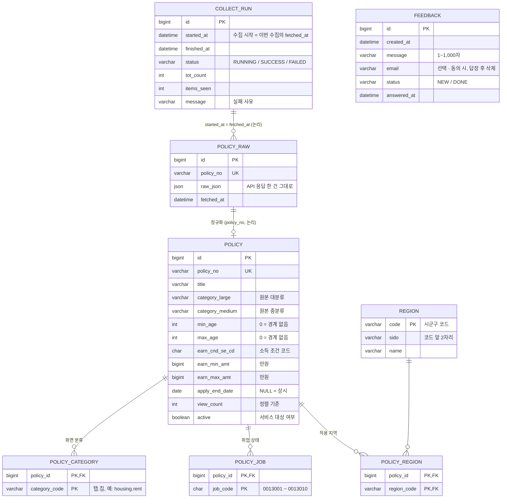

# ERD — 청년정책 매칭 서비스

기준: Flyway 마이그레이션 V1 ~ V8 (2026-11-02). 표 정의의 원본은 [`src/main/resources/db/migration`](../src/main/resources/db/migration)이다.

## 한눈에 보기

| 묶음 | 표 | 하는 일 |
|---|---|---|
| 원본 | `policy_raw` · `collect_run` | API 응답을 받은 그대로 보관하고, 수집할 때마다 성공 여부를 남긴다 |
| 매칭 | `policy` · `region` · `policy_region` · `policy_job` · `policy_category` | 정규화한 정책과, 콤마 다중값을 행으로 풀어 둔 연결 표 |
| 운영 | `feedback` | 화면의 "의견 보내기" |



`policy`는 매칭에 쓰는 열만 그렸다. 화면에 보여 주는 글 열은 아래 [필드 매핑](#필드-매핑-api--policy)에 있다. "논리" 관계는 외래 키 없이 값으로만 이어진다.

## 표별 설명

### 원본

| 표 | 역할 | 왜 이렇게 |
|---|---|---|
| `policy_raw` | API 응답을 정책 한 건씩 JSON 그대로 보관한다. `policy_no`로 upsert하므로 몇 번 수집해도 행이 늘지 않는다 | 규칙이 바뀌면 다시 수집하지 않고 정규화만 다시 돌린다 (D-008). 지금 쓰지 않는 필드(학력 · 전공 등)도 여기 남아 있다 |
| `collect_run` | 수집 한 번이 한 행이다. 시작할 때 `RUNNING`, 끝나면 `SUCCESS` 또는 `FAILED` | 정규화는 **마지막 성공 수집** 이후 확인된 정책만 고른다. 수집이 중간에 실패해도 정상 정책이 빠지지 않는다 (D-017) |

### 매칭

| 표 | 역할 | 왜 이렇게 |
|---|---|---|
| `policy` | 승인된 정책을 매칭 · 표시용으로 정리한 표. 규칙에서 빠지면 지우지 않고 `active = FALSE` | 지우면 연결 표를 먼저 지워야 하고, 다시 나타날 때 id가 바뀐다 (D-014) |
| `region` | 시군구 코드 → 시도 계층표. `sido`는 코드 앞 2자리 | 시도 단위 검색(`r.sido = :sido`)에 쓴다. 정규화 중 처음 보는 코드는 그 자리에서 추가한다 |
| `policy_region` | 정책 ↔ 지역 (N:M) | 원본은 콤마로 이어진 코드 수십~수백 개. 연결 표로 풀어야 인덱스 검색 · 집계 · 외래 키 검사가 된다 ([ADR-001](adr/ADR-001.md)) |
| `policy_job` | 정책 ↔ 취업 상태 코드 | 코드 뜻은 온통청년 공식 코드표로 확인했다. `0013010`(제한없음)은 다른 코드와 함께 붙지 않는다 (D-021) |
| `policy_category` | 정책 ↔ 화면 분류 코드(`탭.칩`) | 원본 중분류를 묶음표(`application.yml`)로 바꾼 코드만 둔다. 원본 이름은 `policy.category_medium`에 그대로 있다 (D-018) |

### 운영

| 표 | 역할 | 왜 이렇게 |
|---|---|---|
| `feedback` | 의견 본문과 답장용 이메일(선택) | 이메일은 동의받은 경우만 저장하고, 답장 처리(`DONE`) 때 바로 지운다. 남은 것도 90일이 지나면 매일 04:30에 지운다. 접속 IP는 저장하지 않는다 (D-024) |

### 규모 (실측)

| 표 | 행 수 | 측정 |
|---|---|---|
| `policy` | 3,843 (모두 활성) | 2026-11-02 자동 갱신 |
| `policy_region` | 207,475 (정책당 평균 약 55) | 2026-10-30, 정책 3,763건 기준 |
| `policy_job` | 4,161 (그중 `0013010` 2,795) | 같음 |
| `policy_category` | 3,826 | 같음 |

## 필드 매핑 (API → policy)

| API 필드 | 표 · 열 | 변환 |
|---|---|---|
| `plcyNo` | `policy_no` | — |
| `plcyAprvSttsCd` | (저장 안 함) | `0044002`(승인)인 정책만 정규화 대상으로 고른다 (D-007) |
| `plcyNm` | `title` | — |
| `lclsfNm` · `mclsfNm` | `category_large` · `category_medium` | 원문 그대로. `mclsfNm`은 묶음표로 바꿔 `policy_category`에도 넣는다 |
| `sprtTrgtMinAge` · `sprtTrgtMaxAge` | `min_age` · `max_age` | 그대로. 매칭에서 `0`은 경계 없음 (D-015) |
| `sprtTrgtAgeLmtYn` | `age_limit_yn` | 그대로 보관만 한다. 나이 값과 맞지 않아 매칭에 쓰지 않는다 (D-015) |
| `earnCndSeCd` | `earn_cnd_se_cd` | `0043001` 무관 · `0043002` 연소득 · `0043003` 기타 |
| `earnMinAmt` · `earnMaxAmt` | `earn_min_amt` · `earn_max_amt` | 10만 이상이면 원 단위로 보고 만원으로 바꾼다 (D-016) |
| `earnEtcCn` | `earn_etc_cn` | 원문. 소득 조건이 "기타"일 때 화면에 그대로 보여 준다 |
| `plcyExplnCn` · `plcySprtCn` | `description` · `support_content` | 원문 |
| `plcyAplyMthdCn` · `sbmsnDcmntCn` | `apply_method` · `required_documents` | 원문 |
| `addAplyQlfcCndCn` | `extra_qualification` | 원문. 값이 있으면 "추가 자격 확인 필요" 표시 (D-003) |
| `etcMttrCn` | `etc_matters` | 원문 |
| `aplyYmd` | `apply_period_text` → `apply_start_date` · `apply_end_date` | `YYYYMMDD ~ YYYYMMDD`를 찾으면 날짜로 바꾸고, 형식이 다르면 날짜를 비운다(= 상시로 취급, 원문은 보여 줌) |
| `aplyUrlAddr` · `refUrlAddr1` | `apply_url` · `ref_url` | 그대로. 칸은 2,048자 (D-019) |
| `sprvsnInstCdNm` | `supervising_org` | — |
| `inqCnt` | `view_count` | 결과 정렬 기준 |
| `zipCd` | `policy_region` | 콤마로 쪼개 행으로 |
| `jobCd` | `policy_job` | 콤마로 쪼개 행으로 |

여기 없는 필드(학력 `schoolCd`, 전공 `plcyMajorCd`, 결혼 `mrgSttsCd`, 특화 조건 `sbizCd` 등)는 `policy_raw.raw_json`에만 있다.

## 매칭 SQL

[`PolicyMatchRepository`](../src/main/java/kr/hojun/policymatch/match/PolicyMatchRepository.java)의 SQL에서 조건 부분을 옮기고 설명을 붙였다. 다중값은 모두 `EXISTS`로 찾는다. `JOIN`과 달리 지역 코드가 여러 개 맞아도 정책이 한 번만 나온다.

```sql
SELECT p.*,
       CASE
         WHEN p.earn_cnd_se_cd = '0043001'                              THEN 'MET'      -- 소득 무관
         WHEN p.earn_cnd_se_cd IS NULL OR p.earn_cnd_se_cd <> '0043002' THEN 'UNKNOWN'  -- 글로만 적힘
         WHEN COALESCE(p.earn_max_amt, 0) = 0                           THEN 'UNKNOWN'  -- 상한 없음
         WHEN :income IS NULL                                           THEN 'UNKNOWN'  -- 소득 미입력
         WHEN :income > p.earn_max_amt                                  THEN 'NOT_MET'
         WHEN COALESCE(p.earn_min_amt, 0) > 0                           THEN 'UNKNOWN'  -- 하한에 다른 기준이 섞인 사례
         ELSE                                                                'MET'
       END AS income_status
FROM policy p
WHERE p.active = TRUE
  AND ( ( (p.min_age IS NULL OR p.min_age = 0 OR p.min_age <= :age)
          AND (p.max_age IS NULL OR p.max_age = 0 OR :age <= p.max_age) )
        OR (p.max_age > 0 AND p.min_age > p.max_age) )                    -- 뒤집힌 값은 포함 (D-001)
  AND ( p.apply_end_date IS NULL OR p.apply_end_date >= CURDATE() )      -- 상시 또는 마감 전
  AND EXISTS (SELECT 1 FROM policy_region pr JOIN region r ON r.code = pr.region_code
              WHERE pr.policy_id = p.id AND r.sido = :sido)
  AND EXISTS (SELECT 1 FROM policy_category pc
              WHERE pc.policy_id = p.id AND pc.category_code IN (:openChips))
  AND ( :job IS NULL
        OR EXISTS (SELECT 1 FROM policy_job pj
                   WHERE pj.policy_id = p.id AND pj.job_code IN ('0013010', :job)) )
ORDER BY p.view_count DESC, p.id
```

## 키와 인덱스

| 표 | 키 · 인덱스 | 쓰임 |
|---|---|---|
| `policy_raw` | `uk_policy_raw_policy_no` | 수집 upsert |
| `policy` | `uk_policy_policy_no` | 정규화 upsert |
| `policy` | `idx_policy_age (min_age, max_age)` | 나이 조건 |
| `policy_region` · `policy_job` · `policy_category` | 기본 키 `(policy_id, 값)` | 같은 연결이 두 번 들어가지 않게 하고, `EXISTS`가 정책 id로 바로 찾는다 |
| `policy_category` | `idx_policy_category_code` | 분류별 집계 |
| `collect_run` | `idx_collect_run_status_started (status, started_at)` | 마지막 성공 수집 찾기 |
| `feedback` | `idx_feedback_status (status, created_at)` · `idx_feedback_created` | 처리 전 목록 · 하루 상한 · 90일 정리 |

외래 키: `policy_region` → `policy`, `region` / `policy_job` → `policy` / `policy_category` → `policy`.

## 마이그레이션 이력

| 버전 | 내용 | 결정 |
|---|---|---|
| V1 | `policy_raw` · `policy` · `region` · `policy_region` | [ADR-001](adr/ADR-001.md) |
| V2 | 소득 열 4개 · `policy_job` · 나이 인덱스 | D-002 |
| V3 | `policy.active` (지우지 않고 비활성) | D-014 |
| V4 | 소득 단위(만원) · `age_limit_yn` 설명 수정 (구조 변경 없음) | D-015, D-016 |
| V5 | `collect_run` | D-017 |
| V6 | `policy_category` | D-018 |
| V7 | URL 2,048자 · 분류 이름 200자로 확장 | D-019 |
| V8 | `feedback` | D-024 |

## 남은 과제

- **`region.name`이 아직 코드와 같다.** 정식 시군구 이름 목록을 채우지 않았다. 시도 이름은 화면용 이름표(`SidoController`)에서 붙인다. 시군구 단위로 검색하려면 먼저 채워야 한다.
- **소득 상한 534(만원) 정책 1건**은 월소득 기준일 가능성이 있어 소득 표시를 믿기 어렵다 ([`quality-check.md`](quality-check.md)).
- 학력 · 전공 · 특화 조건은 원본에만 있다. 매칭에 넣으려면 같은 방식(측정 → 규칙 → 연결 표)으로 검토한다.
